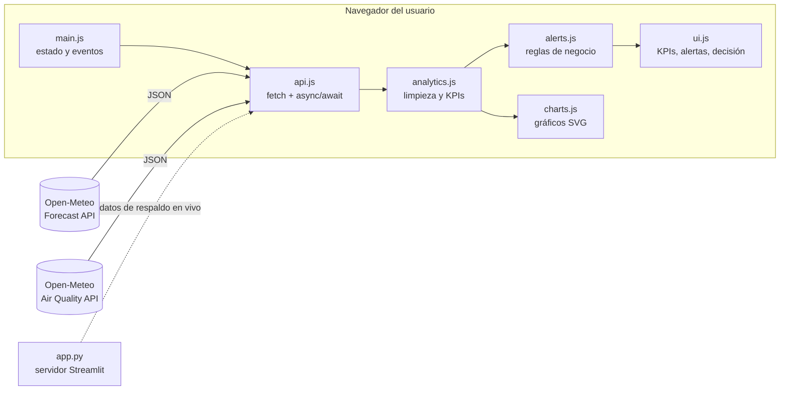
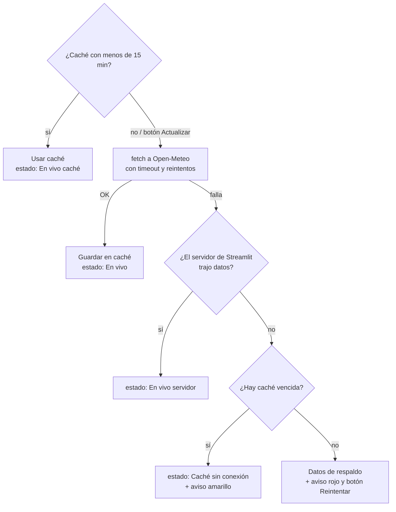

# Documentación técnica

Monitor Climático Operativo · Evaluación Sumativa 3 · Visualización de Datos · INACAP Sede Maipú

Este documento explica **cómo funciona el dashboard por dentro**: de dónde vienen los datos, cómo se transforman en indicadores, cómo se dibujan los gráficos y cómo se generan las recomendaciones.

---

## 1. Visión general

El dashboard es una aplicación web **100 % del lado del cliente** (HTML5 + CSS3 + JavaScript ES6, sin librerías). Streamlit solo actúa como hosting: `app.py` une los archivos en un HTML autocontenido y lo muestra dentro de un iframe.



## 2. Fuentes de datos

Se usan **dos endpoints públicos** de [Open-Meteo](https://open-meteo.com) (gratuitos, sin API key, CORS abierto, licencia CC BY 4.0), consultados **en paralelo**. La ubicación es Maipú (latitud −33,5167; longitud −70,7667) y las URLs se definen en `dashboard/js/config.js`.

| Endpoint | Parámetros principales | Datos que entrega |
|---|---|---|
| `api.open-meteo.com/v1/forecast` | `past_days=7`, `forecast_days=7`, `timeformat=unixtime`, `timezone=America/Santiago` | **current**: temperatura, sensación térmica, humedad y viento actuales.<br>**hourly** (336 h): temperatura, sensación, humedad, probabilidad de lluvia, lluvia (mm), viento y UV.<br>**daily** (14 días): máx./mín., lluvia, viento máx. y UV máx. |
| `air-quality-api.open-meteo.com/v1/air-quality` | `past_days=7`, `forecast_days=5` | **hourly**: PM2,5, PM10 e índice AQI |

Ejemplo abreviado de la respuesta del pronóstico (valores tomados de `fallback-data.js`):

```json
{
  "timezone": "America/Santiago",
  "current": { "time": 1795446000, "temperature_2m": 22.2, "apparent_temperature": 21.3, "relative_humidity_2m": 50, "wind_speed_10m": 14.4 },
  "hourly": {
    "time": [1794798000, 1794801600, "…"],
    "temperature_2m": [18.3, 16.4, "…"],
    "precipitation_probability": [0, 0, "…"]
  },
  "daily": { "time": [1794798000, "…"], "temperature_2m_max": [27.9, "…"], "temperature_2m_min": [10.5, "…"] }
}
```

> Se pide `timeformat=unixtime` para que las fechas sean instantes exactos (segundos UTC). Así el dashboard muestra la hora correcta de Chile aunque el computador que lo abre esté en otra zona horaria.

## 3. Consumo asíncrono y resiliencia (`api.js`)

### 3.1 Petición

```js
async function fetchWithTimeout(url, timeoutMs) {
  const controller = new AbortController();
  const timer = setTimeout(() => controller.abort(), timeoutMs);
  try {
    const response = await fetch(url, { signal: controller.signal });
    if (!response.ok) throw new Error(`HTTP ${response.status}`);
    return await response.json();
  } catch (error) { /* traduce el error a un mensaje claro */ }
  finally { clearTimeout(timer); }
}
```

| Mecanismo | Valor | Para qué sirve |
|---|---|---|
| Tiempo límite (`AbortController`) | 8 s | Evita que una API lenta congele el dashboard |
| Reintentos con backoff exponencial | 2 (espera 0,6 s y 1,2 s) | Supera cortes momentáneos de red |
| Peticiones en paralelo (`Promise.all`) | 2 endpoints | Carga más rápida |
| Caché en memoria + `localStorage` | 15 min | No satura la API (el modelo se actualiza cada hora) |
| Validación del payload | Comprueba `hourly.time`, `temperature_2m`, `daily`, `pm2_5` | Rechaza respuestas incompletas o con error |
| Polling controlado | Cada 10 min, se pausa si la pestaña está oculta | Datos frescos sin consumo innecesario |

### 3.2 Estrategia de degradación

`getEndpoint()` **nunca lanza una excepción hacia la interfaz**: siempre devuelve datos y su origen.



El estado peor de los dos endpoints es el que se muestra en el indicador superior (`En vivo`, `En vivo (servidor)`, `En vivo (caché)`, `Caché sin conexión` o `Modo respaldo`).

### 3.3 Segunda vía en el servidor (`app.py`)

`app.py` descarga los mismos dos endpoints desde el servidor de Streamlit (caché de 10 min con `st.cache_data`) y los inyecta en la página como `window.APP_SERVER_DATA`. Si el navegador del usuario no logra conectarse (red bloqueada, firewall), el dashboard sigue mostrando datos reales.

## 4. Transformación analítica (`analytics.js`)

### 4.1 Limpieza del JSON

`cleanSerie()` convierte los arreglos paralelos de la API (`time[]`, `valor[]`) en una lista de puntos `{ date, value }`:

1. Convierte cada `unixtime` a `Date`.
2. Descarta valores `null` o no numéricos (la API usa `null` donde no hay dato).
3. Ordena cronológicamente.
4. Elimina horas duplicadas.

Luego `filterWindow()` recorta la serie a la ventana elegida (próximas 24 h, 3 días o 7 días) a partir de la hora actual informada por la API.

### 4.2 Indicadores (KPIs)

| KPI | Fórmula | Uso de negocio |
|---|---|---|
| **Horas sobre el umbral** | Cantidad de horas con `T > umbral` | Tiempo en que el andén pierde cadena de frío |
| **Grados-hora (°C·h)** | `Σ max(0, Tₕ − umbral)` | Carga térmica extra que deben compensar los equipos de frío |
| **Costo extra de frío** | `grados-hora × costo CLP por °C·h` | Impacto económico del calor |
| **Bloque crítico** | Tramo continuo más largo sobre el umbral | Horario en que conviene no despachar |
| **Franja más fresca** | Bloque de 4 h con menor temperatura promedio entre 06:00 y 21:00 (próximas 24 h) | Horario recomendado para despachar |
| **Máx. / mín. / promedio** | Extremos y media de la ventana, con fecha y hora | Contexto del período |
| **Variación vs. ayer** | `T actual − T a la misma hora de ayer` | Comparación inmediata |
| **Tendencia de calor** | `promedio máx. próximos 7 días − promedio máx. últimos 7 días` | Anticipa semanas más calurosas |
| **PM2,5 diario** | Peor promedio diario (días con ≥ 12 h de datos) | Comparación con la norma chilena de 50 µg/m³ |

**Ejemplo de cálculo.** Con umbral 27 °C, costo $3.500 por °C·h y tres horas a 28,0 °C, 29,5 °C y 30,0 °C:

```
grados-hora = (28,0 − 27) + (29,5 − 27) + (30,0 − 27) = 1,0 + 2,5 + 3,0 = 6,5 °C·h
costo extra = 6,5 × $3.500 = $22.750
```

Todas estas funciones son **puras** (no tocan el DOM), así que se pueden probar de forma aislada.

## 5. Motor de reglas (`alerts.js`)

Cada regla compara los KPIs con un umbral y, si se cumple, genera una alerta con **severidad, título, evidencia numérica y acción concreta**. Las alertas se ordenan por severidad y la primera se convierte en la **"Decisión sugerida"** del banner superior.

| Regla | Condición | Severidad | Acción recomendada |
|---|---|---|---|
| Calor extremo | Máxima > umbral + 4 °C | Crítica | Suspender despachos refrigerados en el bloque crítico, preenfriar camiones, salir en la franja más fresca |
| Calor | Hay horas sobre el umbral | Alta | Adelantar cargas refrigeradas a la franja más fresca |
| Operación estable | Ninguna hora sobre el umbral | Favorable | Mantener la programación |
| Lluvia | Probabilidad ≥ 60 % o acumulado ≥ 5 mm | Atención / Alta | Cubrir pallets, sumar holgura a las rutas, avisar a clientes |
| Viento | ≥ 40 km/h | Atención | Asegurar carga alta y patio |
| Radiación UV | Índice ≥ 8 (escala OMS) | Atención | Rotar personal de patio entre 12:00 y 16:00 y entregar protección (Ley 20.096) |
| Calidad del aire | PM2,5 diario > 50 µg/m³ | Alta | Reducir trabajo físico al aire libre |
| Tendencia | Próxima semana ≥ 2 °C más calurosa | Atención | Mantención preventiva de equipos de frío |

Todos los umbrales están en `config.js` (`THRESHOLDS`). El umbral de calor y el costo por °C·h los puede cambiar el usuario en pantalla.

## 6. Visualización (`charts.js`)

Gráficos **SVG hechos a mano**, sin Chart.js ni D3.

| Gráfico | Tipo | Por qué este tipo |
|---|---|---|
| Variable seleccionada por hora | Línea + línea de umbral (+ sensación térmica en temperatura) | Muestra la evolución continua y cuándo se cruza el umbral |
| Máxima diaria vs. umbral | Barras divergentes desde 0 (rojo sobre, azul bajo; días pasados atenuados) | Compara cada día contra la meta y separa historia de pronóstico |
| Horas sobre el umbral por día | Columnas | Cuantifica el problema día a día y explica el costo |
| Tendencia en KPIs | Sparkline | Contexto rápido sin ejes |

Decisiones de diseño:
- **Escalas** lineales con ticks "redondos" (1-2-5 × 10ⁿ) y **unidades** en ejes, títulos y tooltips (°C, %, km/h, µg/m³, h, CLP).
- **Sin chartjunk**: grilla tenue, sin 3D, sin sombras, etiquetas directas al final de la línea.
- **Paleta semántica**: rojo = calor/adverso, azul = fresco/favorable. Los colores de estado siempre van con ícono y texto (accesible para daltonismo).
- **Responsivo**: `ResizeObserver` redibuja al cambiar el ancho. En pantallas ≥ 1800 px (proyector) la tipografía aumenta.
- **Animación**: al cambiar filtros, las líneas se interpolan del estado anterior al nuevo con `requestAnimationFrame`, el umbral se desplaza y las barras crecen desde la base. Se respeta `prefers-reduced-motion`.
- **Accesibilidad**: tooltips con mouse, toque y teclado (← → y Esc), `aria-label` en cada gráfico y tabla de datos alternativa.

## 7. Estructura del código

```
.
├── app.py                 Servidor Streamlit: une los archivos y aporta la segunda vía de datos
├── requirements.txt
├── docs/                  Esta documentación
└── dashboard/
    ├── index.html         HTML5 semántico (header, main, section, article, aside, footer, fieldset)
    ├── css/styles.css     Variables CSS, grid/flex, clamp(), modo oscuro, responsive, impresión
    └── js/
        ├── config.js         Ubicación, endpoints, tiempos, parámetros y umbrales
        ├── fallback-data.js  Respaldo con el formato exacto de la API
        ├── format.js         Formato es-CL de números y fechas (America/Santiago)
        ├── api.js            Capa de datos asíncrona y resiliente
        ├── analytics.js      Limpieza y KPIs (funciones puras)
        ├── alerts.js         Motor de reglas → alertas y decisión
        ├── charts.js         Gráficos SVG
        ├── ui.js             Renderizado de componentes
        └── main.js           Estado, eventos, polling y orquestación
```

Los módulos se comunican mediante el espacio de nombres `window.App` y se cargan como **scripts clásicos** en orden de dependencia. Por eso el dashboard también funciona abriendo `index.html` con doble clic (protocolo `file://`).

## 8. Limitaciones conocidas

- La calidad del aire solo se pronostica 5 días. En la ventana de 7 días, el gráfico de PM2,5 cubre menos tiempo (el KPI indica hasta qué día hay datos).
- La "franja más fresca" se calcula solo para las próximas 24 h.
- `fallback-data.js` contiene datos de **demostración** con el formato exacto de la API. Solo se usan si no hay conexión, el servidor no entregó datos y no hay caché.
- El costo por °C·h es un parámetro supuesto del caso de negocio (editable en pantalla), no un dato de la API.
